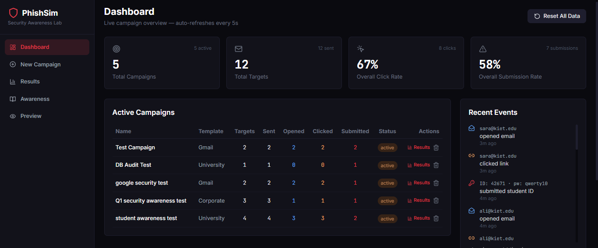
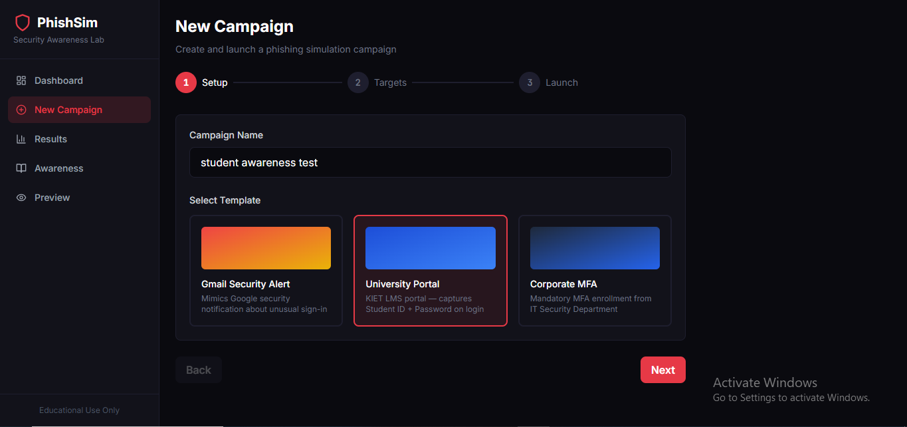
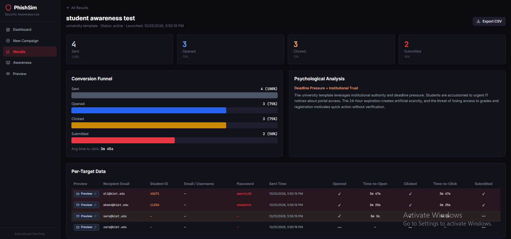
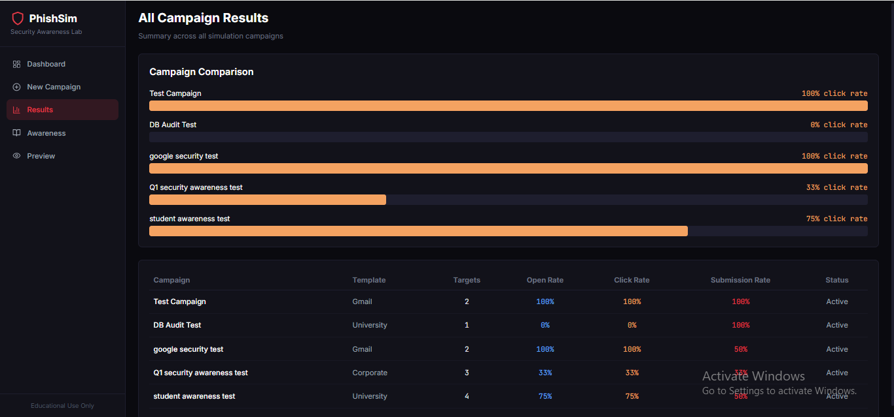
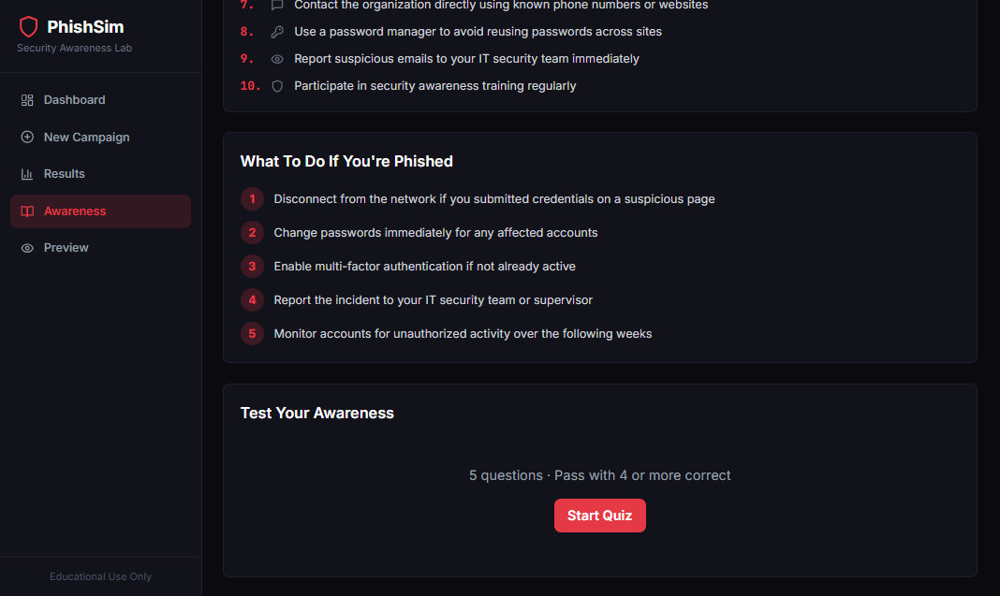

# PhishSim — Phishing Simulation & Security Awareness System

An educational, local-only phishing simulation platform. This tool demonstrates how phishing attacks work, tracks simulated user interactions, and provides security awareness training — **without sending real emails or targeting real users**.

## Ethical Disclaimer

> **This project is for EDUCATIONAL USE ONLY.**
>
> - No real emails are sent to real inboxes
> - All email delivery uses [Ethereal.email](https://ethereal.email) (fake SMTP test service)
> - Passwords are intentionally **never stored** — only email addresses are logged on submission
> - Phishing pages display a visible simulation banner
> - Intended for controlled lab environments with informed participants

**Do not use this tool against real users, real organizations, or production systems.**

## Features

- **Campaign Management** — Create, launch, and delete phishing simulation campaigns
- **3 Phishing Templates** — Gmail, University Portal, and Corporate Intranet scenarios
- **Email Simulation** — Sends via Ethereal test SMTP; a **Preview** button appears next to each recipient after launch
- **Event Tracking** — Email opens (pixel), link clicks, page loads, credential submissions
- **Analytics Dashboard** — Live stats, funnel visualization, per-target timing data
- **Security Awareness** — Educational content with interactive phishing recognition quiz
- **Analyst Preview** — Preview phishing pages and email templates without triggering events

## Prerequisites

- **Node.js 18+** ([download](https://nodejs.org/))
- Windows, macOS, or Linux
- No database setup required (uses JSON file storage via lowdb)

## Installation

```bash
# Clone or navigate to the project
cd phishing-sim

# Install all dependencies (root, server, and client)
npm run install:all
```

## Running the Application

```bash
# Start both server (port 4000) and client (port 5173)
npm run dev
```

Open your browser to:

- **Dashboard:** [http://localhost:5173](http://localhost:5173)
- **API Server:** [http://localhost:4000](http://localhost:4000)
- **Phishing Pages:** [http://localhost:4000/pages/](http://localhost:4000/pages/)

## How to Use

### Step 1: Create a Campaign

1. Navigate to **New Campaign** in the sidebar
2. Enter a campaign name and select a template (Gmail, University, or Corporate)
3. Add target emails (paste one per line, or upload a CSV file)
4. Review the summary and click **Launch Campaign**

### Step 2: View Sent Emails (Ethereal)

After launch, the app shows a **Campaign Launched** screen with a **Sent Email Previews** table. Each recipient has a **Preview** button in front of their email — you do not need the terminal.

1. Click **Preview** next to a recipient (opens Ethereal in a new tab)
2. Read the simulated phishing email
3. Click the CTA or tracking link to simulate victim behavior

You can open the same previews later from **Results** → **Per-Target Data** (Preview column).

### Step 3: Trigger Tracking Events

The simulation tracks these events automatically:

| Event | Trigger |
|-------|---------|
| `email_opened` | Tracking pixel loaded (email opened or page visited) |
| `link_clicked` | Victim clicks the phishing link in the email |
| `page_loaded` | Phishing login page loads |
| `credentials_submitted` | Victim submits the fake login form (email only logged) |

### Step 4: View Results

- **Dashboard** — Live overview with auto-refresh every 5 seconds
- **Results** — Detailed per-campaign analytics, funnel charts, CSV export
- **Awareness** — Educational content and phishing recognition quiz

## How Ethereal Email Works

[Ethereal.email](https://ethereal.email) is a free fake SMTP service for testing email functionality:

- Creates disposable test accounts automatically (and recreates them if login expires)
- "Sends" emails to any address without actual delivery
- Each message gets a web preview URL, shown in the UI as a **Preview** button
- Credentials are saved in `server/data/db.json` for reuse across restarts

**No real person receives these emails.** They exist only as preview pages on Ethereal's website.

## Project Structure

```
phishing-sim/
├── server/
│   ├── index.js              # Express server entry point
│   ├── routes/
│   │   ├── track.js          # Pixel tracking + link click redirects
│   │   ├── submit.js         # Fake credential capture (email only)
│   │   ├── campaigns.js      # Campaign CRUD + launch + reset
│   │   └── results.js        # Analytics endpoints
│   ├── data/
│   │   └── db.json           # lowdb JSON data store
│   └── utils/
│       ├── db.js             # Database initialization
│       ├── emailSender.js    # Nodemailer + Ethereal integration
│       └── trackingPixel.js  # 1x1 transparent GIF helper
│
├── client/
│   └── src/
│       ├── App.jsx           # React Router + sidebar layout
│       ├── components/
│       │   └── EmailPreviewLink.jsx  # On-screen Ethereal Preview button
│       └── pages/
│           ├── Dashboard.jsx
│           ├── NewCampaign.jsx
│           ├── Results.jsx
│           ├── Awareness.jsx
│           └── PhishingPreview.jsx
│
├── phishing-pages/           # Static fake login pages
│   ├── gmail.html
│   ├── university.html
│   └── corporate.html
│
├── email-templates/          # HTML email templates
│   ├── gmail-template.html
│   ├── university-template.html
│   └── corporate-template.html
│
└── package.json              # Root scripts (dev, install:all)
```

## API Endpoints

| Method | Endpoint | Description |
|--------|----------|-------------|
| GET | `/api/campaigns` | List all campaigns |
| POST | `/api/campaigns` | Create campaign |
| POST | `/api/campaigns/:id/launch` | Send emails via Ethereal |
| DELETE | `/api/campaigns/:id` | Delete campaign + related data |
| GET | `/api/results/:campaign_id` | Campaign analytics |
| GET | `/api/results/all` | All campaigns summary |
| GET | `/api/events` | Recent events feed |
| POST | `/api/reset` | Clear all data |
| GET | `/track` | Link click tracking + redirect |
| GET | `/track/pixel/:target_id/:campaign_id` | Email open pixel |
| POST | `/submit` | Credential submission (email only) |

## Screenshots

<!-- Add screenshots of the dashboard, campaign creation, and results pages here -->

_Screenshots placeholder — capture after running the application._

## Scripts

| Command | Description |
|---------|-------------|
| `npm run install:all` | Install root, server, and client dependencies |
| `npm run dev` | Start server + client concurrently |
| `npm run server` | Start Express server only |
| `npm run client` | Start Vite dev server only |
| `npm run build` | Build client for production |

## Ethical Use Statement

This software is provided exclusively for:

- Authorized security awareness training in controlled environments
- Research into phishing techniques with informed, consenting participants

**Prohibited uses:**

- Sending phishing emails to real users without explicit consent
- Impersonating real organizations in production environments
- Collecting real credentials or personal data
- Any activity that violates computer fraud laws or institutional policies

The authors assume no liability for misuse of this tool.


## Screenshots

### 1. Campaign Management Dashboard
Overview of simulation campaigns and analytics.



### 2. Campaign Creation
Configure a campaign and select a simulation template.



### 3. Safe Email Simulation
Preview test emails using Ethereal.email.


### 4. Event Tracking and Analytics
View campaign events and the results funnel.



### 5. All Campaign Results
Overview of analytics across all simulation campaigns.



### 6. Security Awareness Training
Explore educational content and the phishing recognition quiz.




## License

Educational use only. Not licensed for commercial phishing or unauthorized security testing.
